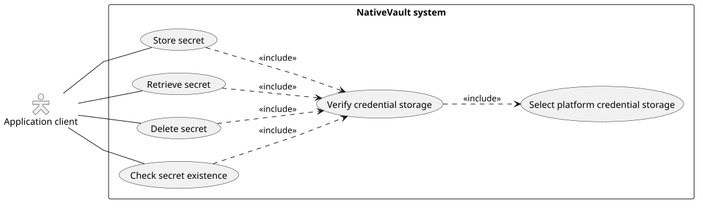
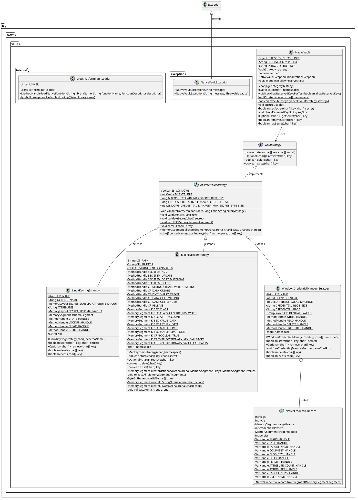

# 🔐 NativeVault

<br>

[](https://lob2018.github.io/native-vault/)
[](https://github.com/lob2018/native-vault/blob/main/CHANGELOG.md)

> [!WARNING]
> This project is currently under active development. APIs are subject to change, and it is not yet recommended for production use.

> [!NOTE]
> **Target Environment**: Designed exclusively for **desktop applications** interacting with active user session secret stores. Incompatible with **headless servers**, system services, or isolated containers.

**Unified Java library interface for secure credential storage backed by active user session operating system managers.**

Powered by the Foreign Function & Memory (FFM) API (**Project Panama**), this library provides a **zero-JNI/JNA** solution featuring strict memory hygiene (`char[]` sanitation via `Arrays.fill`). It is conceptually inspired by [Microsoft's credential-secure-storage-for-java](https://github.com/microsoft/credential-secure-storage-for-java).

# What this library provides

### Available Secure Storage Providers:

| Secret Type / Operation | Windows (Credential Manager)* | Linux (GNOME Keyring / Libsecret)* | macOS (Keychain)* |
| --- | --- | --- | --- |
| Key-Value Credentials (`char[]`) | Yes | Yes | Yes |

<i>*Requires an active desktop session.</i>

# How to use this library

> [!CAUTION]
> OS key stores lack native isolation for cross-application keys:
> * NativeVault prevents key collisions:
>   * **Windows & macOS**: concatenating the key with the namespace defined at instantiation.
>   * **Linux**: isolating keys using the namespace as a distinct schema name/attribute group.
> * **Reserved Keys**: Keys starting with **`__nv_`** are reserved for internal mechanisms (such as integrity checks) and throw an `IllegalArgumentException` if used.
```xml
<dependency>
    <groupId>fr.softsf</groupId>
    <artifactId>native-vault</artifactId>
    <version>1.0.0</version>
</dependency>
```

Here is sample code showing how to use the vault:

```java
// Unique namespace to avoid OS keychain collisions
char[] namespace = {'f', 'r', '.', 's', 'o', 'f', 't', 's', 'f', '.',
    'm', 'y', 'a', 'p', 'p'};
// The unique key to store
char[] key = {'u', 'n', 'i', 'q', 'u', 'e', 'k', 'e', 'y'};
// The secret to store
char[] secret = {'m', 'y', '-', 'c', 'r', 'i', 't', 'i', 'c', 'a', 'l',
    '-', 's', 'e', 'c', 'r', 'e', 't'};
try {
    // Initialize the native vault facade
    NativeVault vault = new NativeVault(namespace);
    // Upsert action: returns true if successfully stored, false otherwise
    boolean stored = vault.setSecret(key, secret);
    // Existence action: returns true if the secret exists, false otherwise
    boolean exists = vault.hasSecret(key);
    // Read action: returns Optional<char[]>
    vault.getSecret(key).ifPresent(rawSecret -> {
        try {
            // Process secret...
        } finally {
            Arrays.fill(rawSecret, '\0'); // Mandatory cleanup for secret buffer
        }
    });
    // Deletion action: returns true if successfully removed, false otherwise
    boolean removed = vault.removeSecret(key);
} catch (NativeVaultException | LinkageError e) {
    // Handle initialization or execution failures safely
    System.err.println("Failed to initialize or use native vault: " + e.getMessage());
} finally {
    Arrays.fill(namespace, '\0'); // Mandatory cleanup for namespace buffer
    Arrays.fill(key, '\0'); // Mandatory cleanup for key buffer
    Arrays.fill(secret, '\0'); // Mandatory cleanup for secret buffer
}
```
# How to build

1. JDK 25+ (required for the FFM API)
2. Maven 3.8+
3. `mvn clean verify`

# Local quick test with JBang

Before running the test script, ensure the project is built and verified:

```bash
mvn clean verify
```

You can then rapidly edit test and validate your vault operations using **JBang**:

```bash
jbang run .myresources/scripts/TestVault.java
```

# Architecture (UML)

**Use case diagram**



**Class diagram**


# License

This project is licensed under the terms of the GNU Affero General Public License v3.0 (AGPLv3).
See the [LICENSE](LICENSE) file for details.
See the [NOTICE.txt](NOTICE.txt) file for required notices and attributions.
